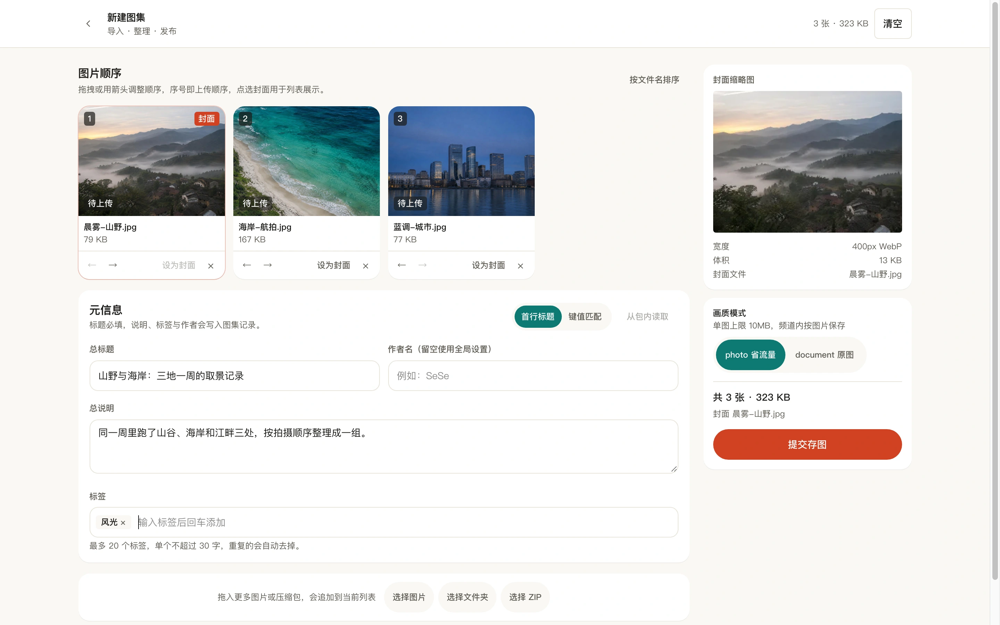
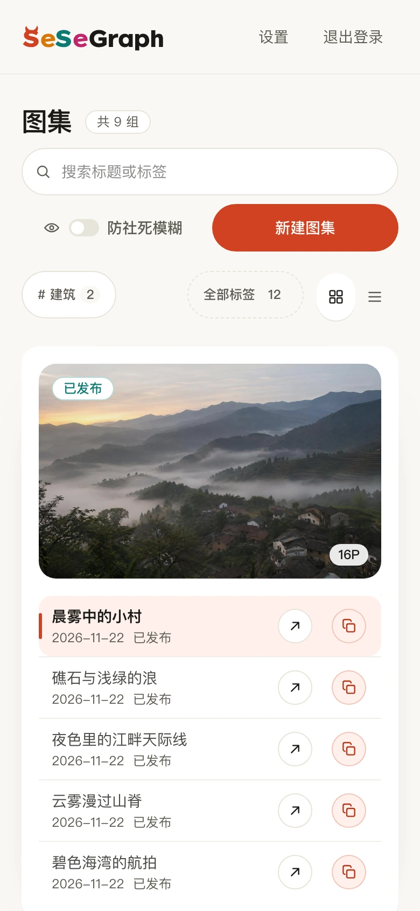

<p align="center">
  
</p>

<p align="center">
  基于 Telegram 私有频道存图、Telegraph 发布图集页面的自托管私人图册管理程序<br />
  单一二进制约 15MB · 空闲常驻内存约 24MB · 内置 SQLite，无需外部数据库
</p>

<p align="center">
  <a href="https://github.com/littleseven2003/SeSeGraph/releases/tag/v1.2.0"></a>
  <a href="https://github.com/littleseven2003/SeSeGraph/pkgs/container/sesegraph"></a>
  
  
  
</p>

<p align="center">
  <a href="#工作原理">工作原理</a> ·
  <a href="#核心特点">核心特点</a> ·
  <a href="#界面预览">界面预览</a> ·
  <a href="#快速开始">快速开始</a> ·
  <a href="#首次使用">首次使用</a> ·
  <a href="#配置说明">配置说明</a>
</p>

<p align="center">
  
</p>

SeSeGraph 是一个自托管的私人图册管理程序。你把本地图片或压缩包上传到后台，程序把图片存入你自己的 Telegram 私有频道，并生成可分享的 Telegraph 图集页面；本地画廊负责索引检索、标签筛选、浏览量查看与隐私遮罩浏览，程序与数据只占一台小内存 VPS 即可。

## 工作原理

1. **存图**：图片通过你自己的 Telegram Bot 上传到私有频道保存，服务端拿到远端文件标识后即删除本地临时文件，服务器硬盘只保留数据库与封面缩略图。
2. **中转**：对外图片地址走本地短码网关 `/i/{short_code}`，由服务端流式向 Telegram 取流转发，访客看不到 Bot Token、频道 ID 或原始文件标识；单帖可随时撤回并停止访问。
3. **发布与管理**：整组图片发布为 Telegraph 图集页（超出单页上限时自动分篇并互相链接），后台画廊统一管理图集、标签、分享链接与 Telegraph 浏览量。

## 核心特点

- **单文件低占用**：前端页面通过 `go:embed` 打包进单个 Go 二进制（linux/amd64 约 15MB，零 CGO），内置 SQLite 存储，空闲常驻内存约 24MB，不需要额外部署 MySQL 或 Redis。
- **浏览器端解包与整理**：直接拖入 ZIP 压缩包、文件夹或多张图片，在浏览器内完成解压、过滤、自然排序、拖拽调序与选封面，不占用服务器 CPU 和内存；可从包内说明文件自动预填标题与标签。
- **限速上传与断点续传**：后台按可配置间隔逐张推送到 Telegram，避免触发接口频控；上传中断后重新拖入同一批文件，会按序号跳过已完成部分继续上传。
- **Telegraph 自动分篇与浏览量**：一键生成单页或多页互链的 Telegraph 图册，支持在线修改标题、说明与作者名；后台定时同步页面浏览量到本地缓存，详情页可手动刷新。
- **防社死模糊遮罩**：画廊封面默认模糊显示，点击后才清晰展示，鼠标移开后立即恢复遮罩；触屏与键盘操作使用短时揭开，方便在公共环境下检索私人图集。
- **流量看护与自动备份**：短码网关支持并发上限、按月出站流量统计、阈值 Bot 提醒与超限熔断（返回 503）；支持每日定时热备 SQLite 并打包发送到私有频道。
- **账号安全管理**：设置页可校验当前密码后修改管理员用户名或密码，修改成功后旧会话立即失效，需要用新凭据重新登录。
- **订阅与永久删除**：启用后提供 `/rss.xml`，只输出已发布、公开、未撤回的图集标题、描述、标签、发布时间与 Telegraph 链接；删除图集会先清空远端页面为「此图集已撤回」，再移除本地记录。

## 界面预览

| 图集详情（含浏览量） | 发布工作台 |
| :---: | :---: |
|  |  |
| 遮罩、精确浏览量、刷新与分享都在同一抽屉里 | 拖入图片即可排序、选封面并预填元信息 |

| 设置与流量看护 | 移动端画廊 |
| :---: | :---: |
|  |  |
| 连通性自检、月度流量与自动备份 | 390px 窄屏适配：焦点轮播与同行标签入口 |

## 快速开始

下面命令与镜像标签按 `v1.2.0` 编写；该版本的 Release 资产与镜像随正式发版提供，若尚未发布请把命令中的版本号换成当前已发布版本（如 `v1.1.1`）。

提供三种部署方式。程序数据目录内只有 `sesegraph.db` 及其 WAL 附属文件、`thumbs/` 封面缩略图、`tmp/` 待上传临时文件和 `backups/` 备份包，迁移或备份直接复制该目录即可。

### Docker Compose（推荐，自动配置 HTTPS）

```bash
mkdir -p /opt/sesegraph && cd /opt/sesegraph
curl -fsSLO https://raw.githubusercontent.com/littleseven2003/SeSeGraph/v1.2.0/docker-compose.yml
mkdir -p deploy && curl -fsSL https://raw.githubusercontent.com/littleseven2003/SeSeGraph/v1.2.0/deploy/Caddyfile -o deploy/Caddyfile
curl -fsSL https://raw.githubusercontent.com/littleseven2003/SeSeGraph/v1.2.0/.env.example -o .env
# 至少填写 DOMAIN、ADMIN_USERNAME、ADMIN_PASSWORD
chmod 600 .env
$EDITOR .env
docker compose up -d
```

镜像从 `ghcr.io/littleseven2003/sesegraph` 拉取。`SESEGRAPH_VERSION` 默认固定为当前版本 `v1.2.0`（需要跟随后续发布时可改为 `latest`），也可用 `SESEGRAPH_IMAGE` 指定自定义镜像地址。宿主机数据保存在 `/opt/sesegraph/data`，Caddy 证书与配置保存在命名卷中。

### 单容器 Docker

```bash
install -d -m 700 /opt/sesegraph
install -d -o 1000 -g 1000 /opt/sesegraph/data
curl -fsSL https://raw.githubusercontent.com/littleseven2003/SeSeGraph/v1.2.0/.env.example \
  -o /opt/sesegraph/sesegraph.env
chmod 600 /opt/sesegraph/sesegraph.env
# 容器内数据目录固定为 /app/data；PUBLIC_URL、管理员账号与上游凭据也在该文件中填写
sed -i 's|^DATA_DIR=.*|DATA_DIR=/app/data|' /opt/sesegraph/sesegraph.env
$EDITOR /opt/sesegraph/sesegraph.env
docker run -d --name sesegraph --restart unless-stopped \
  -p 127.0.0.1:8080:8080 \
  -v /opt/sesegraph/data:/app/data \
  --env-file /opt/sesegraph/sesegraph.env \
  ghcr.io/littleseven2003/sesegraph:v1.2.0
```

凭据通过权限 `0600` 的 `--env-file` 传入，避免密码留在 shell 历史与进程列表中。已有 Nginx 或 Caddy 时，把流量反代到 `http://127.0.0.1:8080` 并关闭响应缓冲（图片网关为流式输出），配置示例见 `deploy/nginx.conf.example` 与 `deploy/Caddyfile.example`。

### 原生单二进制

```bash
install -d /opt/sesegraph
useradd --system --home /opt/sesegraph --shell /usr/sbin/nologin sesegraph || true
curl -fsSL -o /opt/sesegraph/sesegraph \
  https://github.com/littleseven2003/SeSeGraph/releases/download/v1.2.0/sesegraph-v1.2.0-linux-amd64
chmod +x /opt/sesegraph/sesegraph
curl -fsSL https://raw.githubusercontent.com/littleseven2003/SeSeGraph/v1.2.0/deploy/sesegraph.service \
  -o /etc/systemd/system/sesegraph.service
install -d -m 750 /etc/sesegraph
curl -fsSL https://raw.githubusercontent.com/littleseven2003/SeSeGraph/v1.2.0/.env.example \
  -o /etc/sesegraph/sesegraph.env
chmod 600 /etc/sesegraph/sesegraph.env
# 填写 PUBLIC_URL 与上游凭据；监听地址与数据目录由单元文件里的 --addr / --data 指定
$EDITOR /etc/sesegraph/sesegraph.env
systemctl daemon-reload && systemctl enable --now sesegraph
curl -fsS http://127.0.0.1:8080/api/health
```

systemd 单元通过 `StateDirectory` 自动创建并授权 `/var/lib/sesegraph` 作为数据目录。升级时替换二进制后执行 `systemctl restart sesegraph` 即可。Linux、macOS 与 Windows 四个平台的产物和 `SHA256SUMS` 都在 Release 页面。

## 首次使用

服务启动后按四步走完第一次发布：

1. **登录后台**：访问你的域名。部署时在环境变量里填了 `ADMIN_USERNAME` 与 `ADMIN_PASSWORD` 的，直接用这组账号登录；没有预设的，需要同时配置 `ADMIN_SETUP_TOKEN`，首次打开页面时按提示用该凭证完成初始化。之后可在 **设置 → 账号安全 → 修改管理员用户名与密码** 中在线修改，修改成功后旧会话立即失效，需要用新凭据重新登录。
2. **配置 Telegram 图床**：先通过 [@BotFather](https://t.me/BotFather) 创建 Bot 并取得 Token，再新建一个私有频道并把该 Bot 设为管理员（授予发消息权限）。在 **设置** 页面填入 Bot Token 与频道标识（形如 `-100…` 或 `@channel`）并保存；服务器需要代理访问 Telegram 时，可在同一页面配置代理。
3. **申请 Telegraph 账户并自检**：在 **设置 → Telegraph 发布** 中填好默认作者名，点击 **「申请账户」** 自动创建匿名 Telegraph 账户，访问令牌保存在服务端、不回显；也可以改用环境变量 `TELEGRAPH_ACCESS_TOKEN` 手工提供。随后在 **连通性自检** 中确认 Telegram 与 Telegraph 均正常。
4. **发布第一篇图集**：进入 **工作台**，拖入图片文件夹、多张图片或 ZIP 压缩包，调整顺序、点选封面并填写标题与标签，点击 **「提交存图」** 把图片上传到私有频道。存图完成后点击 **「发布到 Telegraph」** 生成图集页面；发布结束后回到 **画廊** 即可浏览、复制外链或分享图集页面。

发布后的 Telegraph 页面与短码图片都可以直接分享给他人访问；在画廊里撤回图集后，本站的图片短码链接会立即停用。

> `v1.1.1` 新增了设置页的「申请账户」按钮与「修改管理员用户名与密码」卡片；升级到该版本后即可使用。

## 配置说明

以下配置由环境变量提供；其中 Bot Token、频道标识、Telegraph 作者名与代理模式可以在登录后的 **设置** 页面在线维护，其余项需改环境变量后重启。环境变量已托管的字段会在界面上标明来源。

| 变量 | 必填 | 说明 |
| --- | :---: | --- |
| `PUBLIC_URL` | 是 | 对外 HTTPS 地址，用于拼接图片外链与分享文案，不能带查询串或凭据 |
| `ADMIN_USERNAME` / `ADMIN_PASSWORD` | 首次 | 仅首次初始化使用，初始化后以数据库中的密码哈希为准 |
| `ADMIN_SETUP_TOKEN` | 二选一 | 未预设管理员账号时，用它在首次打开的页面上完成初始化，初始化后不再生效 |
| `TELEGRAM_BOT_TOKEN` | 是 | 图床 Bot 令牌，需对目标私有频道具备发布权限 |
| `TELEGRAM_CHANNEL_ID` | 是 | 私有频道标识，形如 `-100…`，或 `@channel` 形式的频道用户名 |
| `TELEGRAPH_ACCESS_TOKEN` | 否 | Telegraph 访问令牌；留空时可在设置页点击「申请账户」自动生成 |
| `TELEGRAPH_AUTHOR_NAME` | 否 | Telegraph 页面显示的默认作者名 |
| `LISTEN_ADDR` / `DATA_DIR` | 否 | 监听地址与数据目录，容器内默认 `:8080` 与 `/app/data` |
| `UPLOAD_MODE` | 否 | `photo`（压缩省流量）或 `document`（保留原图）；单帖可在创建时覆盖 |
| `PROXY_CONCURRENCY` | 否 | 图片网关并发上限，满额时立即返回 503（带 `Retry-After`），不排队 |
| `VIEWS_SYNC_MINUTES` | 否 | 后台浏览量同步间隔，默认 30 分钟 |
| `VIEWS_COOLDOWN_SECONDS` | 否 | 详情页手动刷新浏览量的冷却时间，默认 60 秒 |
| `RSS_ENABLED` | 否 | 设为 `true` 且 `PUBLIC_URL` 为有效 HTTPS 地址时提供 `/rss.xml`，默认关闭 |

<details>
<summary>进阶配置：代理、流量看护与自动备份</summary>

| 变量 | 说明 |
| --- | --- |
| `PROXY_MODE` | `direct` 直连、`system` 跟随 `HTTP(S)_PROXY`、`custom` 使用 `PROXY_URL` |
| `PROXY_URL` | 自定义代理地址，可带账密，保存后不会回显 |
| `PROXY_FOR_TELEGRAM` / `PROXY_FOR_TELEGRAPH` | 分别控制 Telegram 与 Telegraph 上游是否走代理 |
| `TRAFFIC_ALERT_GB` | 当月出站流量达到该值后通过 Bot 提醒一次，`0` 表示关闭 |
| `TRAFFIC_LIMIT_GB` | 当月出站流量硬上限，达到后图片网关返回 503 并停止取流，`0` 表示关闭 |
| `BACKUP_ENABLED` / `BACKUP_CRON` | 是否开启每日定时备份，默认每天 `0 3 * * *` |
| `BACKUP_CHANNEL_ID` / `BACKUP_INCLUDE_THUMBS` | 备份推送目标（留空复用图床频道），以及是否打包封面缩略图 |

</details>

## 技术架构

- **后端**：Go 1.22+ 与 Gin，`modernc.org/sqlite` 纯 Go 驱动（零 CGO），SQLite 开启 WAL 与单连接串行写入，启动时自动迁移表结构。
- **前端**：Vue 3 + TypeScript + Tailwind CSS，构建产物通过 `go:embed` 嵌入二进制。
- **图片网关**：按短码流式直通转发，不把整张图读进内存，并做并发限流与按月流量统计。
- **图册发布**：Telegraph 页面按单页图片数量自动分篇并互链；浏览量由后台低频拉取并缓存到本地 SQLite。

## 本地开发

以下命令均在仓库根目录执行：

```bash
make build                   # 构建前端并生成 bin/sesegraph
make test                    # 运行后端测试
make typecheck               # 前端 TypeScript 类型检查
(cd frontend && pnpm test)   # 运行前端单元测试
make frontend                # 仅重新构建并嵌入前端静态资源
make cross                   # 交叉编译四个平台二进制
```

前端独立调试可运行 `cd frontend && pnpm dev`，完成后回到根目录执行 `make frontend` 或 `make build`。本地从源码构建镜像：`docker compose -f docker-compose.yml -f docker-compose.build.yml up -d --build`。

## 升级与备份

- **自动迁移**：从 `v1.0.0`、`v1.1.0` 或 `v1.1.1` 升级到 `v1.2.0` 时，数据库会在启动时自动迁移到结构版本 10（新增图集待删除标记；版本 9 已包含凭据更新用的会话版本列），无需手工执行 SQL。
- **升级前备份**：建议先停止服务并复制整个数据目录，或在设置页点击「立即备份」生成快照。
- **Compose 更新**：先确认 `.env` 中的 `SESEGRAPH_VERSION` 已改成目标版本（或用 `SESEGRAPH_IMAGE` 指定镜像），再执行 `docker compose pull sesegraph && docker compose up -d sesegraph`；`/opt/sesegraph/data` 与 Caddy 证书卷都会保留。

## 版本与许可

- 版本历史见 [CHANGELOG.md](CHANGELOG.md)。推送 `vX.Y.Z` 正式标签（需指向 `main` 且 `CHANGELOG.md` 存在对应小节）会自动产出四平台二进制、`SHA256SUMS` 与 `ghcr.io/littleseven2003/sesegraph` 双架构镜像。
- 本项目采用 [AGPL-3.0](LICENSE) 许可协议。
