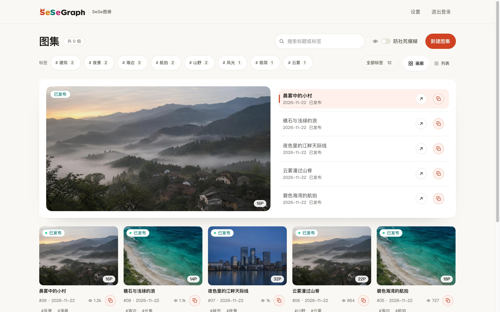
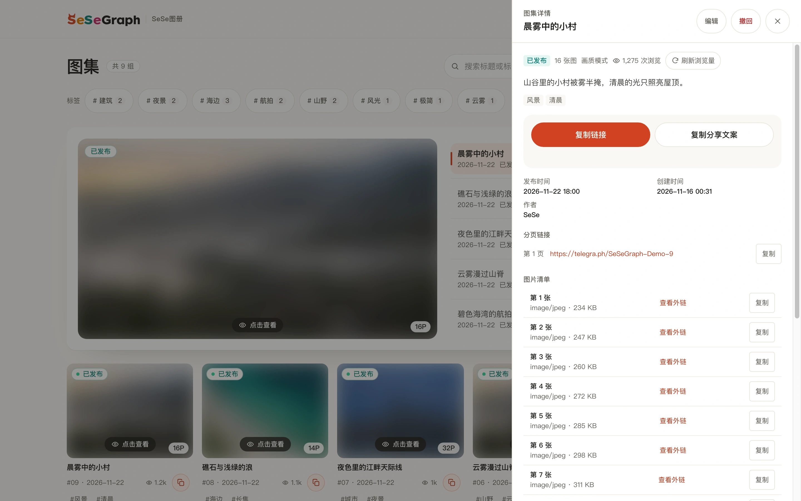
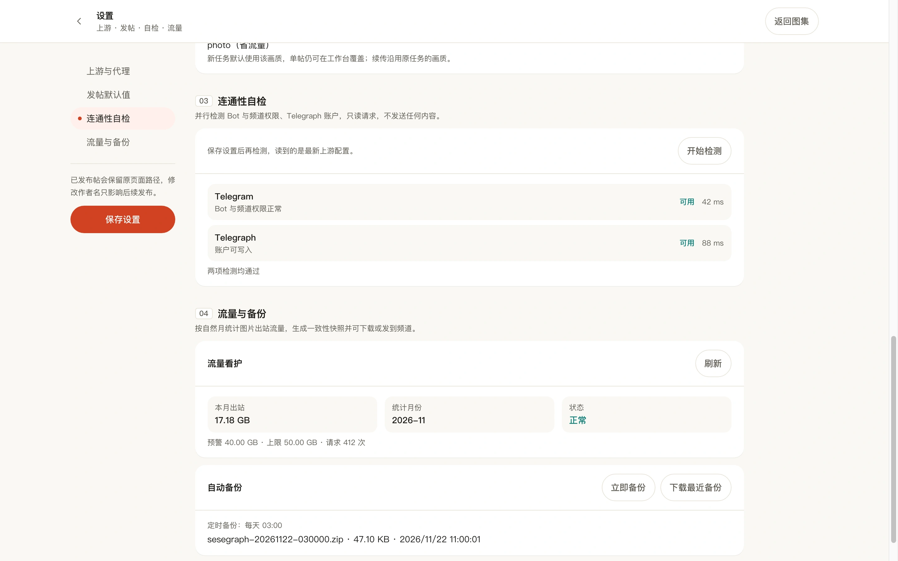

<p align="center">
  
</p>

<p align="center">
  轻量自托管的 Telegram 私有图床与 Telegraph 图册工作台<br />
  单二进制约 14MB · 空闲内存 &lt; 30MB · 纯 Go 零 CGO
</p>

<p align="center">
  <a href="https://github.com/littleseven2003/SeSeGraph/releases/latest"></a>
  <a href="https://github.com/littleseven2003/SeSeGraph/pkgs/container/sesegraph"></a>
  
  
  
</p>

<p align="center">
  <a href="#界面预览">界面预览</a> ·
  <a href="#核心特性">核心特性</a> ·
  <a href="#快速开始">快速开始</a> ·
  <a href="#配置说明">配置说明</a> ·
  <a href="#升级与备份">升级与备份</a>
</p>

<p align="center">
  
</p>

浏览器里解包 ZIP、拖拽排序、选封面，图片存进你自己的 Telegram 私有频道，说明页发到 Telegraph，访客只拿到短码直链。整站一个二进制、一套 SQLite，跑在 512MB 的 VPS 上也不喘。

## 核心特性

- **浏览器端整备**：拖入 ZIP、文件夹或多张图片即可解压、过滤、自然排序，支持拖拽重排、逐张剔除与点选封面，元信息可从包内说明文件预填。
- **私有图床**：后台按可配间隔逐张推送到 Telegram 私有频道，拿到远端标识后立刻删除临时文件；断网或关页后用同一批文件重选即可按序号续传。
- **Telegraph 图册**：一键把整帖发成多页 Telegraph 页面并自动互链，记录页面路径与浏览量；单帖可在线改标题、说明与作者。
- **防社死遮罩**：默认把封面糊住，点一下才揭开，鼠标移开立刻重新遮住；触屏与键盘用短时揭开，适合放在公共场合翻自己的图集。
- **短码图片网关**：`/i/{short_code}` 流式直通上游，不落盘、不带凭据；支持并发上限、按月流量看护与超限熔断。
- **轻量运维**：单一二进制内嵌前端，SQLite 自动迁移；内置每日自动备份、在线设置与连通性自检，512MB VPS 可跑。

## 界面预览

| 图集详情（含浏览量） | 发布工作台 |
| :---: | :---: |
|  |  |
| 遮罩、精确浏览量、刷新与分享都在同一抽屉里 | 拖入图片即可排序、选封面并预填元信息 |

| 设置与流量看护 | 移动端画廊 |
| :---: | :---: |
|  |  |
| 连通性自检、月度流量与自动备份 | 390px 窄屏适配：焦点轮播与同行标签入口 |

## 快速开始

三种形态任选其一。数据目录里只有 `sesegraph.db` 及其 WAL 附属文件、`thumbs/` 封面缩略图、`tmp/` 待上传临时文件和 `backups/` 快照，备份即复制整个目录。

### Docker Compose（推荐，自带 HTTPS）

```bash
mkdir -p /opt/sesegraph && cd /opt/sesegraph
curl -fsSLO https://raw.githubusercontent.com/littleseven2003/SeSeGraph/v1.1.0/docker-compose.yml
mkdir -p deploy && curl -fsSL https://raw.githubusercontent.com/littleseven2003/SeSeGraph/v1.1.0/deploy/Caddyfile -o deploy/Caddyfile
curl -fsSL https://raw.githubusercontent.com/littleseven2003/SeSeGraph/v1.1.0/.env.example -o .env
# 至少填写 DOMAIN、ADMIN_USERNAME、ADMIN_PASSWORD
$EDITOR .env
docker compose up -d
```

应用镜像从 `ghcr.io/littleseven2003/sesegraph` 拉取，`SESEGRAPH_VERSION` 固定版本、`SESEGRAPH_IMAGE` 可换成自定义地址。本文件的 `SESEGRAPH_VERSION` 默认固定到当前发布版 `v1.1.0`，需要跟随后续发布时显式改成 `latest` 再 `docker compose pull`。宿主机数据目录是 `/opt/sesegraph/data`，Caddy 的证书与配置保存在命名卷里。

### 单容器 Docker

```bash
install -d -m 700 /opt/sesegraph
install -d -o 1000 -g 1000 /opt/sesegraph/data
curl -fsSL https://raw.githubusercontent.com/littleseven2003/SeSeGraph/v1.1.0/.env.example \
  -o /opt/sesegraph/sesegraph.env
chmod 600 /opt/sesegraph/sesegraph.env
# 容器内数据目录固定为 /app/data；PUBLIC_URL、管理员账号与上游凭据也在该文件中填写
sed -i 's|^DATA_DIR=.*|DATA_DIR=/app/data|' /opt/sesegraph/sesegraph.env
$EDITOR /opt/sesegraph/sesegraph.env
docker run -d --name sesegraph --restart unless-stopped \
  -p 127.0.0.1:8080:8080 \
  -v /opt/sesegraph/data:/app/data \
  --env-file /opt/sesegraph/sesegraph.env \
  ghcr.io/littleseven2003/sesegraph:v1.1.0
```

凭据放在权限 `0600` 的环境文件里由 `--env-file` 读取，不要把密码写进命令行，以免留在 shell 历史与进程列表里。反向代理指向 `http://127.0.0.1:8080`，并关闭响应缓冲（图片网关是流式输出）。`deploy/nginx.conf.example` 与 `deploy/Caddyfile.example` 可直接参考。

### 原生单二进制

```bash
install -d /opt/sesegraph
useradd --system --home /opt/sesegraph --shell /usr/sbin/nologin sesegraph || true
curl -fsSL -o /opt/sesegraph/sesegraph \
  https://github.com/littleseven2003/SeSeGraph/releases/download/v1.1.0/sesegraph-v1.1.0-linux-amd64
chmod +x /opt/sesegraph/sesegraph
curl -fsSL https://raw.githubusercontent.com/littleseven2003/SeSeGraph/v1.1.0/deploy/sesegraph.service \
  -o /etc/systemd/system/sesegraph.service
install -d -m 750 /etc/sesegraph
curl -fsSL https://raw.githubusercontent.com/littleseven2003/SeSeGraph/v1.1.0/.env.example \
  -o /etc/sesegraph/sesegraph.env
chmod 600 /etc/sesegraph/sesegraph.env
# 填写 PUBLIC_URL 与上游凭据；监听地址与数据目录由单元文件里的 --addr / --data 指定
$EDITOR /etc/sesegraph/sesegraph.env
systemctl daemon-reload && systemctl enable --now sesegraph
curl -fsS http://127.0.0.1:8080/api/health
```

单元文件用 `StateDirectory` 建好 `/var/lib/sesegraph` 并授权给运行用户，数据库、`thumbs/`、`tmp/`、`backups/` 都在这里；升级时只替换二进制再 `systemctl restart sesegraph`。四个平台的产物与 `SHA256SUMS` 都在 Release 页。

## 配置说明

| 变量 | 必填 | 说明 |
| --- | :---: | --- |
| `PUBLIC_URL` | 是 | 对外 HTTPS 地址，用于拼图片外链与分享文案，不能带查询串或凭据 |
| `ADMIN_USERNAME` / `ADMIN_PASSWORD` | 首次 | 仅首次初始化使用，之后以数据库中的哈希为准 |
| `TELEGRAM_BOT_TOKEN` | 是 | 图床 Bot，需对目标私密频道有发送权限 |
| `TELEGRAM_CHANNEL_ID` | 是 | 私密频道标识，形如 `-100…`，或使用 `@channel` |
| `TELEGRAPH_ACCESS_TOKEN` | 是 | Telegraph 账户令牌，也可在设置页申请后写入 |
| `TELEGRAPH_AUTHOR_NAME` | 否 | 发布页面显示的作者名 |
| `LISTEN_ADDR` / `DATA_DIR` | 否 | 监听地址与数据目录，容器内默认 `:8080` 与 `/app/data` |
| `UPLOAD_MODE` | 否 | `photo` 省流量或 `document` 原图 |
| `PROXY_CONCURRENCY` | 否 | 图片网关并发上限，满额立即返回 503，不排队 |
| `VIEWS_SYNC_MINUTES` | 否 | 浏览量同步间隔，默认 30 分钟 |
| `VIEWS_COOLDOWN_SECONDS` | 否 | 详情页手动刷新的冷却，默认 60 秒 |

<details>
<summary>代理、流量看护与自动备份</summary>

| 变量 | 说明 |
| --- | --- |
| `PROXY_MODE` | `direct` 直连、`system` 跟随 `HTTP(S)_PROXY`、`custom` 使用 `PROXY_URL` |
| `PROXY_FOR_TELEGRAM` / `PROXY_FOR_TELEGRAPH` | 分别控制两项上游是否走代理 |
| `TRAFFIC_ALERT_GB` | 当月出站达到该值经 Bot 提醒一次，0 表示关闭 |
| `TRAFFIC_LIMIT_GB` | 当月出站上限，达到后图片网关返回 503 并停止取流 |
| `BACKUP_ENABLED` / `BACKUP_CRON` | 每日定时备份，默认 `0 3 * * *` |
| `BACKUP_CHANNEL_ID` / `BACKUP_INCLUDE_THUMBS` | 备份可发送到频道，可选是否包含封面缩略图 |

</details>

## 技术架构

- **后端**：Go 1.22 + Gin，`modernc.org/sqlite` 纯 Go 驱动（零 CGO），SQLite 以 WAL 加单连接串行访问，数据库结构版本随启动自动迁移。
- **前端**：Vue 3 + TypeScript + Tailwind，构建产物通过 `go:embed` 打进二进制，部署时只有一个可执行文件。
- **存储**：图片经 Telegram Bot API 存入私有频道；对外只暴露短码网关，流式转发并限制并发与月度流量。
- **发布**：Telegraph 页面按图片数自动分篇并互链；浏览量由后台低频同步到本地缓存，接口只读缓存。

## 本地开发

```bash
make build          # 构建前端并生成 bin/sesegraph
make test           # 后端测试
make typecheck      # 前端类型检查
(cd frontend && pnpm test)   # 前端单元测试
make frontend       # 仅重新构建并嵌入前端资源
make cross          # 四个平台交叉编译
```

以上命令都在仓库根目录执行，`make cross` 同样依赖根目录的 `Makefile` 与 `backend/`，不要在 `frontend/` 里调用。前端单独开发时 `cd frontend && pnpm dev`，回到根目录再执行嵌入或打包。本地从源码构建镜像：`docker compose -f docker-compose.yml -f docker-compose.build.yml up -d --build`。

## 版本与变更

版本历史见 [CHANGELOG.md](CHANGELOG.md)，当前正式版 `v1.1.0`。推送形如 `vX.Y.Z` 的正式标签（须指向 `main`，且 CHANGELOG 有对应小节）会触发发布：产出四平台二进制、`SHA256SUMS` 与 `ghcr.io/littleseven2003/sesegraph` 的双架构镜像，先验证版本镜像的架构清单、健康接口与匿名拉取，再推进 `latest` 与 Release。

## 升级与备份

从 `v1.0.0` 升级时数据库会自动迁移到结构版本 8（新增浏览量缓存字段），无需手工执行 SQL；升级前建议先停服务并复制整个数据目录，或使用设置页的「立即备份」生成快照。Compose 部署的更新方式是 `docker compose pull sesegraph && docker compose up -d sesegraph`，命名卷与 `/opt/sesegraph/data` 都会保留。

## 许可

[AGPL-3.0](LICENSE)
